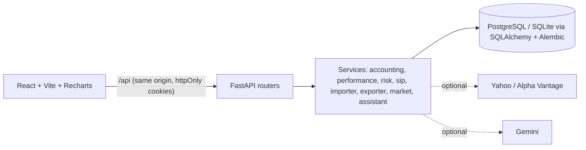

# Portfolio Tracker

A full-stack portfolio analytics app: record buys and sells, see live (delayed) prices, returns, risk, SIP goals, import/export Excel and CSV, and ask an assistant about your own numbers.
**Educational project using data you enter. Not investment advice.**

> Screenshots: add `docs/screenshots/dashboard.png` etc. and embed them here (see `docs/screenshots/README.txt`).

## Features

| Area | What it does |
|---|---|
| Accounts | Register/login. Short-lived access token + rotating refresh token in **httpOnly cookies** (no token in localStorage), CSRF header, login rate limit and per-account lockout, PBKDF2-SHA256 (600k) with automatic upgrade of old hashes |
| Transactions | Buy/sell with fees, edit, delete (with confirmation), filter by date/stock/type. Selling more than you hold is rejected, including via edits/deletes of older buys |
| Accounting | Weighted-average cost basis; realized and unrealized P&L; overall return (rules below) |
| Market data | Provider abstraction: Yahoo Finance (no key), Alpha Vantage (key), or Demo mode (no prices). Search by name/ticker, NSE/BSE suffixes, 5-minute cache, rate-limit and not-found handling, "last updated" |
| Dashboard | KPI cards, value over time, invested vs value, sector and stock allocation, monthly returns, P&L distribution, portfolio vs benchmark, 1W-All filters, honest empty states |
| Performance | Daily/weekly/monthly/cumulative (time-weighted) returns, annualised (only with 365+ days), best/worst periods, growth % (Pandas) |
| Risk | Stock and sector concentration, HHI, diversification score, volatility, max drawdown, Sharpe, risk score + category, and an explanation of every metric |
| Import/Export | CSV and .xlsx upload with row-level validation, duplicate detection, preview, confirm/cancel. Export holdings, transactions, P&L, analytics (CSV) and a 4+ sheet Excel report |
| AI assistant | TF-IDF glossary retrieval + answers computed from the signed-in user's own data; optional Gemini only rewords computed facts; graceful fallbacks |
| Goal planner | SIP maths, required SIP, year-wise growth, saved goals, up to 6 compared scenarios |
| UI | Sidebar, dark/light/system theme, mobile drawer, profile menu, toasts, skeleton loaders, confirm dialogs, empty and error states |

## Architecture



```
backend/app/
  main.py            app setup, CORS, security headers, startup migrations
  config.py          environment config + production safety checks
  security.py        hashing, tokens, cookies, current user
  models.py          User, Position, Transaction, PriceHistory, PortfolioSnapshot, Goal, UserPreference, ImportBatch, RefreshToken, AuditLog
  routers/           auth, transactions(+legacy /holdings), portfolio, market, goals, data, assistant, settings
  services/          pure business logic (no web framework): accounting, performance, risk, sip, importer, exporter, market, portfolio (DB glue)
  assistant.py       glossary retrieval + portfolio-aware answers
backend/alembic/     migrations (0001 baseline, 0002 transactions + data conversion)
backend/tests/       pytest
frontend/src/        api.js, context/, components/, pages/, lib/ (pure helpers + node tests)
```

## Accounting rules (weighted-average cost)

* BUY: `cost += qty * price + fees`, `qty += q`
* SELL: `avg = cost / qty`; `realized += (q * price - fees) - q * avg`; `cost -= q * avg`; `qty -= q`
* Unrealized P&L = market value - cost of shares still held
* Total P&L = realized + unrealized. Overall return = total P&L / everything spent on buys (fees included)
* Same-day order: buys before sells. Replay is chronological, so a sale can never exceed shares held at that moment
* Holdings with no price are listed as "missing" and left out of market-value totals (never valued at zero)

**Performance** is time-weighted: `r = V_t / (V_prev + net_flow_t) - 1`, so deposits are not gains. Portfolio value is rebuilt from your transactions and stored daily closes. Prices carried forward over holidays (max 5 days) are flagged as estimates; days with a missing price beyond that are skipped, never invented.

## Run locally

Backend (Python 3.11+):
```bash
cd backend
python -m venv .venv && source .venv/bin/activate      # Windows: .venv\Scripts\activate
pip install -r requirements.txt -r requirements-dev.txt
uvicorn app.main:app --reload                          # http://localhost:8000/docs  (migrations run automatically)
pytest -q
```
Frontend (Node 20+), in a second terminal:
```bash
cd frontend
npm install
npm run dev        # http://localhost:5173  (the dev server proxies /api to the backend)
npm test           # pure-helper tests (node's built-in runner)
```
Use `http://localhost:5173` (not 127.0.0.1) consistently. For prices without a key, nothing to configure (Yahoo is the default).

Everything in Docker (Postgres + API + nginx-served frontend):
```bash
cp .env.example .env     # set SECRET_KEY and POSTGRES_PASSWORD
docker compose up --build        # http://localhost:8080
```

## Upgrading an existing v1 database

Keep your old `portfolio.db` in `backend/` and start the app. Alembic runs `0001` (baseline, creates nothing that exists) and `0002`, which adds the new tables and converts every legacy holding into one BUY transaction + a position keeping its sector and price. The legacy `holdings` table is **never modified or dropped**. Legacy buy dates were not stored, so converted transactions are dated on the migration day and say so in their note; edit the dates in Transactions for accurate performance. Back up first anyway: `cp portfolio.db portfolio.db.bak`. Manual run: `python -m app.migrate`.

## Environment variables

See `.env.example`. Key ones: `ENV`, `SECRET_KEY` (required, 32+ chars, in production the app refuses to start without it), `DATABASE_URL`, `CORS_ORIGINS`, `COOKIE_SECURE`, `TRUST_PROXY`, `MARKET_DATA_PROVIDER` (`yahoo`|`alphavantage`|`demo`), `ALPHAVANTAGE_API_KEY`, `GEMINI_API_KEY`, `BENCHMARK_SYMBOL`, `RISK_FREE_RATE_PCT`. API keys live only in the backend; the frontend never sees them.

## API (full interactive docs at `/docs` in development)

| Area | Endpoints |
|---|---|
| Auth | `POST /auth/register`, `/auth/login`, `/auth/refresh`, `/auth/logout`, `/auth/change-password`; `GET/PUT /auth/me` |
| Transactions | `GET/POST /transactions`, `PUT/DELETE /transactions/{id}` (`?confirm=true`), `GET /positions`, `PATCH /positions/{id}` |
| Legacy | `GET/POST /holdings`, `PUT/DELETE /holdings/{id}` (deprecated, kept for old clients) |
| Portfolio | `GET /portfolio/summary`, `/portfolio/performance?period=1W..ALL`, `/portfolio/risk`, `/portfolio/snapshots` |
| Market | `GET /market/status`, `/market/search?q=`, `/market/quote/{symbol}`; `POST /market/refresh` |
| Goals | `POST /goal/plan`, `/goal/compare`; `GET/POST /goals`, `PUT/DELETE /goals/{id}` |
| Data | `GET /data/template.csv`; `POST /data/import/preview`, `/data/import/{id}/confirm`; `DELETE /data/import/{id}`; `GET /data/export/{holdings,transactions,pnl,analytics}.csv`, `/data/export/report.xlsx` |
| Other | `POST /assistant/ask`, `GET/PUT /settings/preferences`, `GET /audit`, `GET /health` |

## Deployment (API on Render, frontend on Vercel)

Cookies need the app and API to share a site, so the frontend proxies `/api` to the API:
1. **Render**: create from `render.yaml` (API + Postgres). Set `CORS_ORIGINS` to your Vercel URL and optionally `GEMINI_API_KEY`.
2. **Vercel**: import the repo, root directory `frontend`. Edit `frontend/vercel.json` and put your Render URL in the rewrite destination. Deploy.
3. Open the Vercel URL, register, add transactions, click "Refresh prices".
The API refuses to start in production with the dev secret, no `CORS_ORIGINS`, or insecure cookies.

## Security notes

httpOnly + Secure + SameSite=Lax cookies; 30-minute access token, 14-day refresh token stored only as a SHA-256 hash, rotated on use, and reuse revokes all sessions; CSRF header on cookie-authenticated writes; explicit CORS origins; every query filtered by the authenticated user id; Pydantic validation and DB check constraints; spreadsheet formula injection neutralised on import and export; security headers and `Cache-Control: no-store`; no secrets in code; Docker image runs as non-root.

## Limitations (please read)

* Yahoo Finance access is **unofficial**: it can change, block or throttle without notice. Prices are delayed/end-of-day. Alpha Vantage's free tier is tiny (about 25 calls/day, ~100 days of history).
* **Demo mode** (no provider/key) has no prices at all by design. Prices are never invented; enter them manually instead.
* Symbols are stored as typed (e.g. `INFY.NS`); `INFY` and `INFY.NS` count as different symbols.
* Performance is only as good as the stored prices: run "Refresh prices" to load history. Dividends, splits and bonus issues are not modelled.
* Risk and volatility need history (20+ daily returns; Sharpe 60+). The risk score is a screening aid, not a full risk measure.
* The in-memory rate limiter is per process (use Redis for multiple instances). Registering reveals whether an email exists.
* Projections assume a constant return, so they are estimates, not guarantees.
